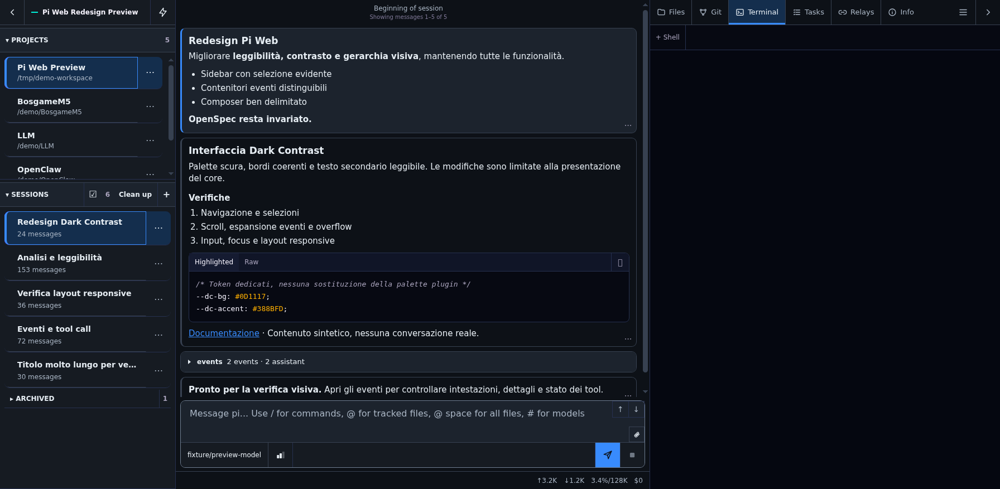

# Dark Contrast — a Pi Web theme

A dark, higher-contrast theme for [Pi Web](https://pi-web.dev) that makes the interface easier to read during long sessions, **without restyling your plugins**.



<sub>Screenshot from the test harness: synthetic projects, sessions and messages, no real workspace data.</sub>

## What it is

A **theme package** for Pi Web — CSS only. No JavaScript, no server module, no dependencies. It appears in **Settings → General → Theme** as *Dark Contrast* and can be applied to one browser or set as the gateway default.

## What it is for

Pi Web's default dark palette is pleasant but low-contrast in dense screens: session rows blur together, paths compete with titles, tool output is hard to scan, and the composer does not stand out. Dark Contrast targets exactly that:

| Problem | What the theme changes |
| --- | --- |
| Sidebar rows blend together | Panel-style section headers, rounded rows, a visible accent edge on the current item, titles separated from paths and metadata |
| Chat is flat and tiring | Message frames with a readable leading edge, larger body text, separated event groups |
| Tool calls look alike | Distinct card headers, and success / error / running states that are not conveyed by colour alone |
| Hard to tell where the input is | Bounded composer, legible placeholder, clear focus ring, highlighted default submit action |
| Layout drifts from the reference mockup | On wide screens, navigation 314px and tool panel 35vw (with the original 360px minimum); breakpoints, collapsed panels, scroll behaviour and native `hidden`/`disabled` states are untouched |

Palette: background `#0D1117`, sidebar `#161B22`, panels `#1C232D`, borders `#374151`, text `#E6EDF3`, secondary text `#AAB6C5`, accent `#388BFD`, success `#3FB950`, error `#F85149`. Text pairs meet WCAG AA, and the composer border keeps a 3:1 non-text contrast.

## Why plugins are not restyled

A selected Pi Web theme replaces the global palette, and plugins inherit it. To keep plugin UIs (OpenSpec and others) on their own colours, this theme ships a byte-identical copy of the official **PI WEB Dark** palette (`assets/base-pi-web-dark.css`) and overlays only rules scoped to core components (`:host(chat-view)`, `:host(session-list)`, …).

No `--pi-*` variable is redefined and no plugin content selector is targeted: plugin panels look exactly as they did before. That is a deliberate trade-off — if you expected the whole window to be redesigned at once, plugin panels will look unchanged.

## Install

```bash
pi install npm:pi-web-dark-contrast
```

Reload the browser, then choose **Settings → General → Theme → Dark Contrast** and press **Use in this browser** (one device) or **Set gateway default** (everyone on that gateway). No session-daemon restart is needed: it is a declarative theme.

## Compatibility

| Item | Value |
| --- | --- |
| Tested with Pi Web | `1.202611.1` (commit `98316bd`) |
| Runtime code | none — CSS-only, declarative theme |
| Restart needed | no; a browser reload is enough |

Some core chrome and CodeMirror selectors are still experimental in Pi Web, so re-check the appearance after a Pi Web upgrade. If a future release adds new palette tokens, refresh the bundled official baseline (`assets/base-pi-web-dark.css`).

## Uninstall / rollback

Pick another theme in Settings (or **Use the default** in that browser), then:

```bash
pi remove npm:pi-web-dark-contrast
```

No data, session or preference is migrated: removing the package only removes the theme.

## Development

```bash
npm run build   # regenerates assets/theme.css (baseline + tokens + scoped rules)
npm test        # static checks: theme metadata, palette hash, selector isolation, contrast
```

| Path | Content |
| --- | --- |
| `assets/base-pi-web-dark.css` | official PI WEB Dark palette, unmodified (sha256 `88b39cf2…7692`) |
| `assets/tokens.css` | `--dc-*` palette used by the scoped rules |
| `assets/dark-contrast.css` | core-only rules |
| `assets/theme.css` | generated; the single sheet Pi Web publishes atomically |
| `tests/` | static checks, isolated preview harness, verification evidence (not shipped to npm) |
| `docs/` | screenshots used by this README |

The verification covers static isolation tests, a six-viewport browser matrix, and a real-instance check that a plugin panel keeps its computed styles and all inherited `--pi-*` tokens. Full report: [`tests/evidence/verification.md`](tests/evidence/verification.md) (Italian).

## License

MIT
